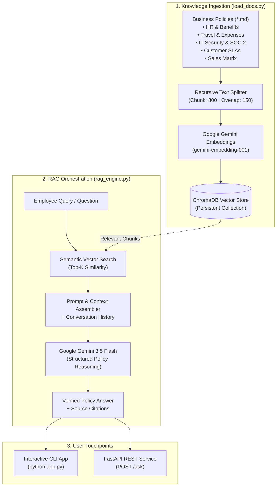

# Enterprise Knowledge RAG 🏢🤖

[](https://www.python.org/)
[](https://aistudio.google.com/)
[](https://www.trychroma.com/)
[](https://fastapi.tiangolo.com/)
[](https://opensource.org/licenses/MIT)

> An enterprise-grade, retrieval-augmented generation (**RAG**) assistant designed for internal business operations, HR benefits, corporate travel, procurement limits, IT security compliance, and customer SLA management. Powered by **Google Gemini** and **ChromaDB**.

---

## 🌟 Business Overview

In modern enterprises, critical company knowledge is often fragmented across multiple PDFs, wikis, Notion workspaces, and handbook documents. Employees spend hours searching for travel rules, spending limits, or parental leave policies, while HR and IT teams answer the same repetitive questions every day.

**Enterprise Knowledge RAG** solves this by providing a unified, trustworthy AI copilot:
- **100% Policy-Grounded**: Answers are synthesized strictly from authorized company policy documents—no hallucinations, no guessing.
- **Transparent Citations**: Every response references the exact policy document and section from which the answer was retrieved.
- **Multi-Turn Memory**: Follow-up questions maintain context across the conversation.
- **Enterprise-Ready Dual Access**: Includes an interactive command-line assistant (CLI) for employees and a high-performance **FastAPI** backend for Slackbot, Teams, or intranet portal integration.

---

## 🏛️ System Architecture



---

## 📂 Project Structure

```
enterprise-knowledge-rag/
├── docs/                                  # Official business knowledge base (Markdown)
│   ├── 1_company_overview_and_directory.md # Executive team, offices, communication channels
│   ├── 2_hr_benefits_and_workplace_policies.md # PTO, parental leave, health insurance, 401(k)
│   ├── 3_finance_travel_and_procurement.md # Travel flights, per-diem, spending approvals
│   ├── 4_it_security_and_compliance.md    # Password complexity, MFA, BYOD, SOC2/GDPR
│   ├── 5_customer_success_and_service_level_agreements.md # SLA response times, service credits
│   └── 6_sales_playbook_and_commercial_pricing.md # Product tiers, discount thresholds, Net 30
├── chroma_db/                             # Persistent vector index (generated on ingestion)
├── config.py                              # Central configuration & parameters
├── load_docs.py                           # Document chunking & embedding ingestion pipeline
├── rag_engine.py                          # Core RAG retrieval, citation & Gemini generator
├── app.py                                 # Interactive CLI terminal copilot
├── api.py                                 # Production FastAPI REST service
├── test_rag.py                            # Automated policy verification test suite
├── test_api.py                            # Gemini API connectivity health check
├── test_search.py                         # Direct semantic search diagnostic tool
├── requirements.txt                       # Project dependencies
├── .env.example                           # Template for environment variables
└── README.md                              # Project documentation
```

---

## 🚀 Quickstart Guide

### 1. Prerequisites
- **Python 3.10+**
- A **Google Gemini API Key** (Free tier available at [Google AI Studio](https://aistudio.google.com/))

### 2. Installation & Setup
```bash
# 1. Clone the repository
git clone https://github.com/mohammedben10/enterprise-knowledge-rag.git
cd enterprise-knowledge-rag

# 2. Create and activate a virtual environment
python -m venv .venv
source .venv/bin/activate       # macOS / Linux
# or: .\.venv\Scripts\Activate.ps1 # Windows PowerShell

# 3. Install dependencies
pip install -r requirements.txt

# 4. Configure your API key
cp .env.example .env
# Edit .env and insert your GOOGLE_API_KEY
```

### 3. Ingest Business Documents
Ingest the enterprise documents and create the ChromaDB vector database:
```bash
python load_docs.py
```

*Output:*
```text
📂 Found 6 business policy documents in 'docs':
   • 1_company_overview_and_directory.md
   • 2_hr_benefits_and_workplace_policies.md
   • 3_finance_travel_and_procurement.md
   • 4_it_security_and_compliance.md
   • 5_customer_success_and_service_level_agreements.md
   • 6_sales_playbook_and_commercial_pricing.md

🧩 Split 6 documents into 36 contextual chunks.
🧠 Connecting to embedding model: 'models/gemini-embedding-001'...
💾 Generating embeddings and storing vectors into ChromaDB...
✅ Vector database successfully built and persisted to disk!
```

---

## 💬 Running the Assistant

### Mode A: Interactive Web UI (Recommended)
Launch the server to access the full-featured, responsive browser interface:
```bash
uvicorn api:app --reload --port 8000
```
Open **[http://localhost:8000](http://localhost:8000)** in your browser.

✨ **Web Interface Features**:
- **Modern Chat Stream**: Clean conversational UI with markdown formatting, bold text, and bullet lists.
- **Transparent Citations**: Every answer includes clickable policy source badges (`[Source: HR Policies & Benefits]`).
- **Quick-Prompt Suggestions**: One-click prompt pills for common questions (flights, parental leave, spending approvals, SLAs).
- **Live Policy Drawer**: Sidebar dynamically lists all active corporate documents loaded in the vector database.
- **Session Memory**: Natural follow-up questions with a "Clear Chat" button to reset context.

---

### Mode B: Interactive Command Line (CLI)
Chat directly with the business assistant in your terminal:
```bash
python app.py
```

#### Sample Interaction:
```text
👤 You: What is the policy for flights that are 6 or more hours long?

🔍 Searching policy documents & formulating response...

🤖 Copilot:
According to the Corporate Travel, Expenses & Procurement Policy:
- Flights exceeding 6 hours across time zones qualify for Premium Economy or Business Class booking with Director approval to ensure readiness for client meetings.
- Short-haul and domestic flights under 6 hours must be booked in standard Economy.

📚 Sources Consulted:
   • Apex Global Technologies — Corporate Travel, Expenses & Procurement Policy (3_finance_travel_and_procurement.md)
----------------------------------------------------------------------

👤 You: And what is our daily meal allowance while traveling internationally?

🤖 Copilot:
For international business travel, the daily per-diem meal allowance is $120 per day ($25 breakfast, $35 lunch, $60 dinner).

📚 Sources Consulted:
   • Apex Global Technologies — Corporate Travel, Expenses & Procurement Policy (3_finance_travel_and_procurement.md)
```

---

### Mode C: REST API (FastAPI)
Launch the API server for intranet, Slackbot, or Teams integrations:
```bash
uvicorn api:app --reload --port 8000
```

Access interactive Swagger documentation at **[http://localhost:8000/docs](http://localhost:8000/docs)**.

#### Endpoint Reference:
| Method | Endpoint | Description |
| :--- | :--- | :--- |
| `GET` | `/health` | Check service health, active LLM model, and vector collection status |
| `GET` | `/documents` | List all official policy documents currently loaded |
| `POST` | `/ask` | Submit questions and receive policy-grounded answers with citations |

#### Example Request:
```bash
curl -X POST "http://localhost:8000/ask" \
     -H "Content-Type: application/json" \
     -d '{"question": "How many weeks of parental leave do primary caregivers get?"}'
```

#### Example Response:
```json
{
  "question": "How many weeks of parental leave do primary caregivers get?",
  "answer": "Primary caregivers receive 16 weeks of 100% fully paid parental leave following the birth, adoption, or foster placement of a child. Employees are eligible after 90 days of continuous service.",
  "sources": [
    {
      "file": "2_hr_benefits_and_workplace_policies.md",
      "title": "Apex Global Technologies — HR Policies, Benefits & Workplace Guidelines"
    }
  ],
  "retrieved_chunks_count": 3
}
```

---

## 🧪 Automated Testing

Run the included verification test suite:
```bash
python test_rag.py
```

This verifies that queries across **HR, Finance, Travel, IT Security, and Customer SLAs** produce accurate, sourced answers matching company policy.

---

## 🛡️ Security & Privacy Best Practices

- **Zero Data Leakage**: Sensitive credentials and API keys are managed exclusively via `.env` (gitignored).
- **Strict Grounding**: The LLM system prompt prevents hallucination and directs employees to relevant support channels (`#ask-hr`, `#ask-finance`, `#it-helpdesk`) if an answer is not present in official policies.
- **Enterprise Access Controls**: Document chunks can be extended with department tags (e.g., `access_tier: executive`) for role-based retrieval filtering.

---

## 📄 License
This project is open-source under the [MIT License](LICENSE).
